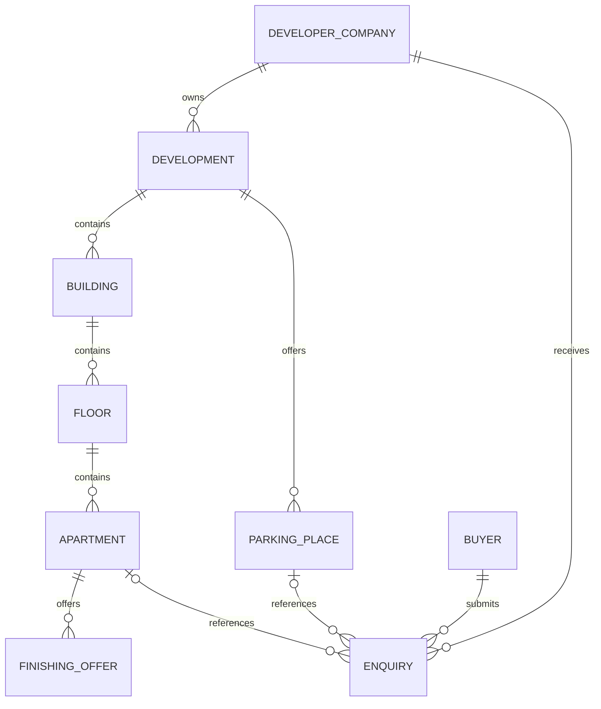

# Domain Model and Data Dictionary

The logical model below defines domain meaning and ownership for database and API design. It describes the fields required by the agreed workflows; it does not prescribe unreviewed physical table names or migration details.

## Ownership chain

An enquiry references one selected apartment or one parking place. The two optional diagram associations express alternative object types, not an enquiry with no selected object. The accepted snapshot retains the relevant offer and price context.

## Entity dictionary

| Entity | Main data | Integrity and use |
| --- | --- | --- |
| User | Email, password credential, role, buyer verification; optional buyer name/surname/phone | Buyer-only operations require verification. Credentials stay outside public/audit outputs. |
| Developer company | Representative account, presentation/contact information, access state | One developer account per company; owns developments and their private content. |
| Development | Name, city, address, coordinates, cover, translated descriptions, construction status and conditional quarter/year | Publication state and administrative restriction remain separate. |
| Building | Parent development, identifier/title, facade asset, declared floors | Every floor belongs to this building and company. |
| Floor | Building, floor number, plan asset and orientation | Reviewed floor and apartment mappings stay within their target building/floor. |
| Physical apartment | Floor, number, rooms, area, bathrooms, layout, base condition, base price and availability | One identity and one availability state across all finishing offers. |
| Additional finishing offer | Apartment, finishing type, full price, translated description and optional media/model | Optional; cannot replace or duplicate physical apartment availability. |
| Managed asset | Owner, related object, storage reference, type and metadata | Private/public serving follows the related object's permissions and visibility. |
| Region mapping | Source image, geometry, floor/apartment target and review state | A candidate is distinct from a reviewed saved association. |
| Infrastructure point | Development/location context, category, coordinates and retained description/source/correction data | Supports maps and factual explanations; developer corrections retain the intended object context. |
| Parking place | Development/scheme, place identifier, availability and commercial context | Available places can receive place-specific enquiries. |
| Panorama point | Supplied image and configured point transitions | Optional; every referenced point belongs to the relevant tour. |
| Favourite | Buyer and physical apartment reference | Own buyer access; current status is retained without bypassing visibility. |
| Enquiry | Buyer, owning company, selected object/offer, contact data, submitted price/context, date, processing and archive state | Accepted context remains historical after later stock changes. |
| Audit event | Actor, affected object, successful change, timestamp and permitted change values | Immutable to ordinary users; excludes credentials and unnecessary contact payloads. |
| Reference value | City or finishing type, labels and active state | Referenced values cannot be deleted; deactivation prevents new assignment without breaking existing use/search. |
| Processing job | Owner/source reference, operation, processing state, output/error references | Job completion is independent of publication and administrative restoration. |

Comparison contains up to four apartment/offer selections in the current user context. Guest selections survive sign-in; persistence across browser restarts is not prescribed. This does not require a separate persistent comparison entity.

## Translation model

Populated public development, apartment, finishing and company descriptions and gallery captions contain Russian, Kazakh and English versions. Proper names, addresses and identifiers are exempt. The implementation may choose an appropriate storage representation while preserving these field-level rules; images do not require translated copies.

## Enquiry snapshot and live data

Live apartment price, status and finishing offers support current selection. The accepted enquiry separately preserves what was submitted and confirmed. A later price edit, offer removal or processing-status update cannot silently rewrite that historical commercial context.

See [[states]] for invariants, [[contracts]] for input/output responsibilities and [[requirements]] for acceptance.
