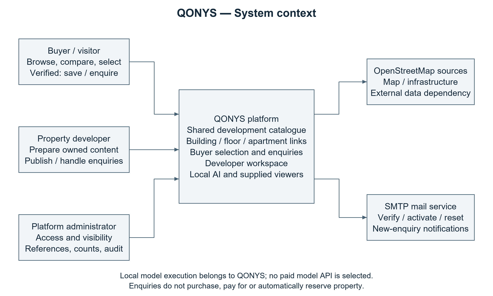
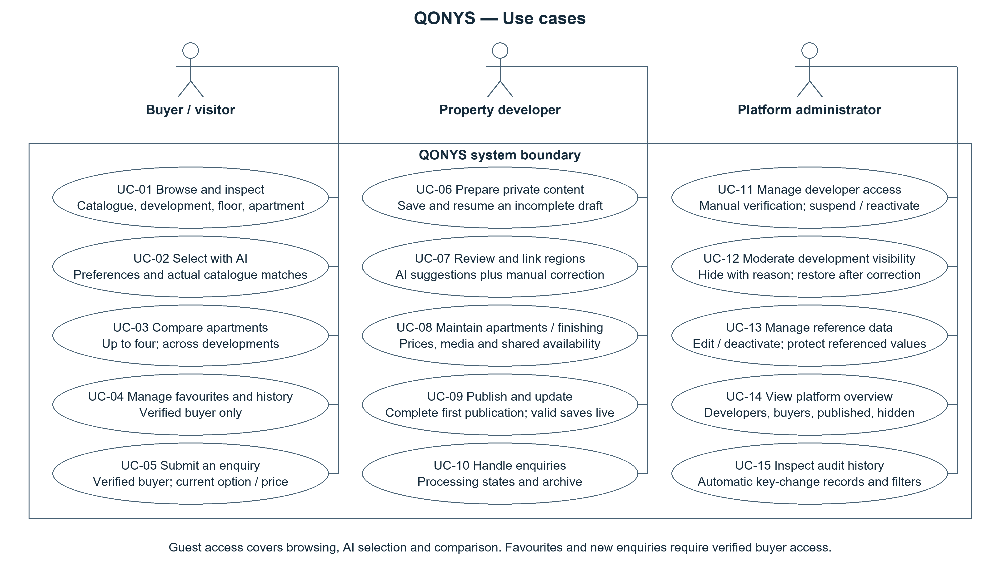
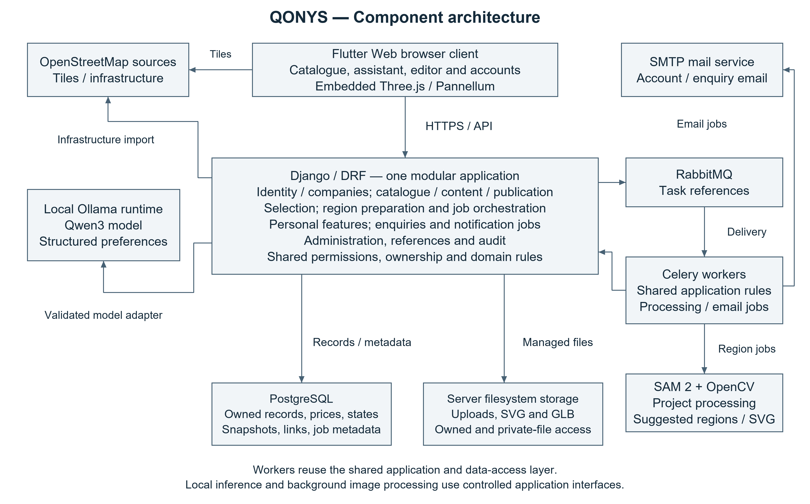
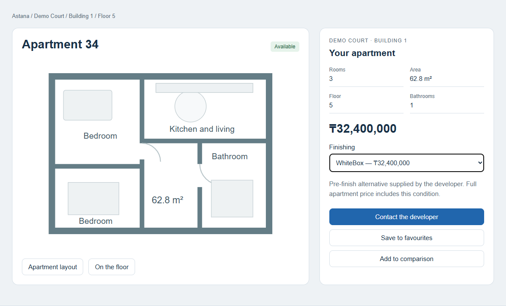
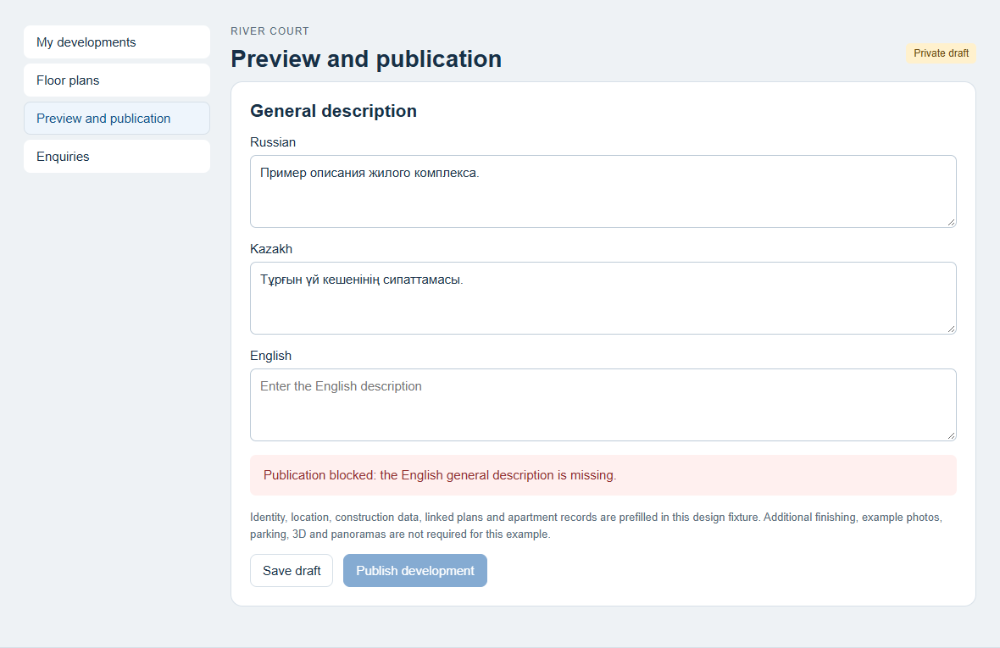
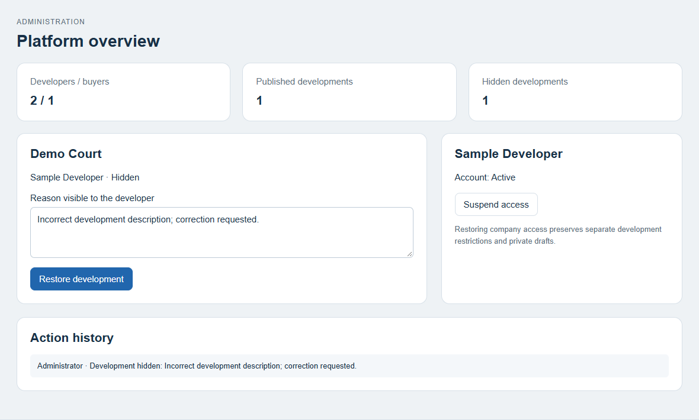

# Development of an AI-Powered Residential Real Estate Visualization and Intelligent Property Selection Platform with 3D Site Visualization, Floor-Level Layouts, and Interactive Mapping

Analysis and Design Submission

24 October 2026

Team: Temirlan Almukhamedov, Yevgeniy Averyanov and Bexultan Nishanbek

Supervisor: Islam Omirzak

## Submission overview

QONYS is designed to combine a shared residential-development catalogue, physical-apartment selection, interactive floor layouts, infrastructure maps and optional developer-supplied visual assets. Its AI functions are limited to catalogue-grounded buyer preference interpretation and correctable image-region suggestions. Developers publish their own complete reviewed developments, and administrators manage developer access and public restrictions.

The analysis and design milestone produced an agreed scope, findings from three interviews, literature and system comparisons, 40 functional and 10 non-functional requirements with acceptance criteria, architectural diagrams and an interactive scenario prototype. A verification protocol and implementation plan connect these design decisions to the next project stage. The report presents the completed analysis and design work; its application behaviour is specified by the requirements and prototype.

## Contents

1. Project proposal
2. Evidence of relevance
3. Literature review
4. Existing system comparison
5. Technology comparison
6. Requirements specification
7. Architecture and diagrams
8. UX and prototype
9. Verification and evaluation plan
10. Project management and risks
11. Supervisor feedback

# 1 Project proposal

## Team and supervisor

Temirlan Almukhamedov is the Systems Analyst and Technical Coordinator. Yevgeniy Averyanov is responsible for backend development. Bexultan Nishanbek is responsible for Flutter Web and frontend development. Islam Omirzak is the supervisor.

## Problem statement

Apartment buyers need to compare properties across different developers using price, area, room count, floor, finishing and location. Relevant information is often presented in separate development websites, listing pages, building images, floor plans and maps. Buyers must connect these materials themselves to understand where a particular apartment is located, whether it is available and how it compares with other offers.

Developers also need to maintain the links between building photographs, floor plans and apartment records. Preparing selectable floor and apartment regions manually requires tracing boundaries and assigning each region to the correct record. Automated suggestions may reduce this effort, but incorrect boundaries or record links require review and correction before publication.

QONYS addresses these tasks through one catalogue with interactive building and floor images, structured apartment information, cross-development comparison, infrastructure maps and natural-language property selection. The evaluation plan defines how the integrated workflow and AI-assisted region preparation will be assessed against manual baselines at a comparable final quality level.

## Target users

Buyers use the platform to explore residential developments, inspect floors and apartment layouts, compare offers, save favourites, examine the surrounding infrastructure and send enquiries.

Property developers manage their own developments, buildings, floors, apartments, parking and supporting visual material. They review AI-suggested regions, correct their geometry, assign catalogue records and handle enquiries through their workspace.

Platform administrators create developer accounts after manual verification and can suspend or restore developer access. They can hide a development with a reason visible to the developer and restore its public display after correction. Suspending a developer hides all of its developments while preserving data and enquiries. Developers publish their own reviewed materials, but cannot bypass an administrative restriction. Administrators also edit city and finishing-type reference lists and view counts of developers, buyers, published developments and hidden developments. Realtors are outside the defined roles.

The first version uses one developer account per company. An emailed activation link lets the representative set their own password after administrator account creation; password recovery also uses email. On account reactivation, previously published developments hidden only by company suspension return to public display if otherwise valid. Individually hidden developments retain their restriction, and private drafts remain private.

Administrators can view and filter automatic audit records for developer suspension/reactivation, development hiding/restoration and apartment price/availability changes. Referenced cities and finishing types cannot be deleted; they can be deactivated for future selection while existing objects and their search access are preserved. Buyer blocking is outside the first version.

## Aim

The aim is to develop a residential property platform that helps buyers select and compare apartments across developers using structured catalogue information, natural-language preferences, interactive building images, floor-level layouts, optional developer-supplied 3D visualizations and infrastructure maps, while helping developers prepare and maintain interactive floor and apartment regions with AI assistance and manual correction.

## Objectives

1. Investigate buyer and developer needs through user/client discussions and a critical review of related systems and research.
2. Develop a catalogue of residential complexes from different developers with city selection and consistent list/map views.
3. Implement navigation from a development and building to a selected floor plan and a linked apartment record.
4. Provide apartment details, finishing choices, favourites and comparison across residential developments and developers.
5. Implement a buyer selection tool that interprets natural-language preferences, retrieves actual catalogue properties and explains their relevance.
6. Develop and evaluate AI-assisted suggestions for visible floor regions on building images and apartment regions on floor plans, including manual correction and record assignment.
7. Integrate development location and nearby infrastructure information using a cartographic service and an agreed data source.
8. Support the upload and display of optional site 3D scenes, linked 360-degree panoramas and apartment 3D models supplied by developers.
9. Provide developer content management, administrator-managed developer access and internal apartment/parking enquiries.
10. Define and execute functional, access-control, usability, recommendation and content-preparation evaluations, distinguishing planned targets from observed results.

## Expected outcomes

The final project deliverable is an integrated application prototype covering the main buyer, developer and administrator scenarios. Buyers will be able to move from the catalogue to a development, building, floor and apartment, compare records and send an enquiry associated with the chosen property and finishing option. Developers will be able to maintain their own property information, visual material, region mappings and enquiry statuses.

Developers can save private development drafts and fill them gradually. A development is published as a complete object only after all mandatory information and mappings are ready; partial public publication is excluded. Optional 3D models and panoramas are not prerequisites for an otherwise complete development. Description content uses defined text fields and a gallery with optional captions; every populated description/caption must be complete in Russian, Kazakh and English before publication.

Construction status is required; an under-construction development also provides a planned completion quarter and year. Housing class is optional. First-publication criteria are consolidated in the requirements section.

After initial publication, all valid saved changes become visible immediately, including descriptions, plans, media, prices and availability. There is no additional republish step. The apartment list supports bulk price and availability updates. The workspace contains My developments, Enquiries, Company and Account settings, with dedicated editing sections inside each development.

The AI design combines catalogue-based buyer selection with editable image-region suggestions and a manual preparation path. The evaluation plan covers region quality, correction effort, record-link correctness, preparation time, workflow completion and compliance with mandatory buyer preferences.

The work completed for 24 October comprises the proposal, analysis of three interviews, literature and system comparisons, a requirements matrix with acceptance criteria, three architectural diagrams, an interactive design prototype, and verification and delivery plans. The following scope describes the application specified by these materials.

## Project scope

### Catalogue and buyer navigation

The main page shows residential complexes for the selected city in list or map mode. A development contains one or more buildings. Selecting a visible floor region on a building image opens the associated floor plan. Apartment regions refer to separate catalogue records; apartment price, area and availability are entered by the developer rather than inferred from an image.

A development's layout section filters apartments within that development and displays individual apartment cards rather than grouping identical layouts across floors. The natural-language selection tool operates across the platform catalogue. Buyers can compare up to four apartments from different developments and developers by development, developer, location, room count, area, floor, bathrooms, selected finishing, price and availability. The selected finishing option and its price remain part of the comparison context. Guests can browse, use AI selection and compare apartments. Favourites and enquiry submission require buyer sign-in. Buyers use email and password with email-based recovery and must verify their email during registration before account access is granted.

The development page has its title and local navigation at the top: Overview, Layouts, Map and infrastructure, Parking, and 3D and panoramas. Overview starts with the interactive facade and building/floor selection, followed by description, characteristics and gallery. Absent optional sections are hidden. Reserved and Sold apartments are excluded from new selection results but retained in existing favourites/comparison with their current status. Direct apartment-detail links remain viewable; new enquiries are disabled while unavailable and current availability is checked on submission.

### Apartment information and enquiries

Apartment information includes the supplied 2D layout, room count, area, bathrooms, building, floor, developer-configured base finishing condition, price, availability and other supported characteristics. The base condition may differ between developments; it is not hardcoded as finished delivery or inferred from uploaded media. Extra finishing variants and example photos are optional, so the base apartment remains usable without additional option records. Additional variants can have their own price, description, images and optional 3D model, while physical availability remains shared. A compact dropdown beneath the price selects among offered conditions; a single condition is shown as text. The base condition is initially selected unless a valid explicit comparison or AI context identifies another offer. The selection retains its context in comparison and enquiries.

An apartment with no additional variant uses its own 2D layout and price; no separately entered default-finishing record is required. An explicit comparison/AI presentation context is retained. An enquiry uses the current base/selected-variant price: a changed price requires confirmation, a removed selected option requires a valid replacement, and submission records the presentation and price as a historical snapshot. Public descriptions are stored in Russian, Kazakh and English; supplied images retain their original content. Private drafts support gradual entry of the three text versions.

Public manager telephone numbers are not displayed. An enquiry form collects buyer contact information and an optional comment; the selected object is attached automatically. The developer workspace shows enquiries for that developer's objects and new enquiries trigger SMTP email notifications. Developers update enquiry processing through New, In progress, Processed and Cancelled states and can archive completed enquiries for later viewing. Permanent deletion by the developer is excluded from the first version. Buyers can view their own enquiries, including the object, submission date and current processing status, in their account alongside Favourites and Account settings. Buyer profile name, surname and phone are optional before the first enquiry, editable in settings and prefilled in the enquiry form, where the buyer can correct them. Password can be changed; email is displayed without an address-change workflow. Signing in preserves the guest comparison list. Sending an enquiry does not reserve, purchase or pay for a property.

Parking uses an interactive scheme. Available spaces can be selected to send an enquiry; unavailable spaces cannot be selected. Payment and automatic parking reservation are outside scope.

### AI-assisted region preparation

A developer uploads a building image or floor-plan image. The system proposes editable regions for visible floors or apartments, respectively. The developer reviews the result, moves or adds boundaries where needed, removes incorrect regions and assigns each region to a floor or apartment record.

A prepared floor plan and its reviewed SVG regions can be copied to matching floors. Each target floor has separate apartment identities, numbers, prices and availability, and the developer checks the copied associations before publication.

Facade recognition and apartment-region recognition are separate tasks. A visible facade does not provide the internal floor plan. Detecting rooms does not automatically establish the full boundaries or catalogue identity of an apartment. The design therefore separates candidate geometry, developer correction and reviewed record assignment. The evaluation plan assesses the two image tasks separately.

### Intelligent buyer selection

The buyer describes preferences in Russian, Kazakh or English. The AI interprets the text into supported parameters and the backend checks actual catalogue properties against explicit city, budget and other hard constraints. Stated preferences affect result ordering. Explanations use available catalogue and infrastructure evidence. If no exact matches exist, the system states this and proposes a specific constraint change; a new search follows buyer confirmation. The assistant responds in the language of the buyer's message independently of the interface language.

A floating button on public catalogue and property pages opens a compact chat overlay. The expanded desktop view places conversation and conditions beside apartment results; the mobile view occupies the screen. Opening an apartment minimizes the assistant and retains the current session context. The interface supports Russian, Kazakh and English; developer-supplied public descriptions use all three languages. Private drafts support gradual translation entry. The selected approach uses local Qwen3 through Ollama with server-side preference validation.

The assistant does not answer questions by retrieving uploaded developer documents. A developer chatbot is also excluded.

### Optional visual material

The platform supports three independent types of developer-supplied material: an interactive 3D scene of the site and buildings, linked 360-degree panoramas, and an apartment 3D model, which may show an unfinished space or a prepared interior. The corresponding interface section is displayed only when usable material exists.

Developer-supplied scenes use GLB and Three.js with rotation, zoom and camera-angle changes. Panoramic JPEG images use Pannellum for looking around and moving between points. Both viewers are embedded in Flutter Web. Optional 3D content complements the required image-based floor and apartment navigation.

### Technical baseline and exclusions

The baseline is Flutter Web, Django with Django REST Framework, PostgreSQL, Celery and RabbitMQ. The application architecture is a modular monolith with shared PostgreSQL and background workers. Managed uploads use server filesystem storage through Django, with ownership, references and metadata in PostgreSQL. Maps use OpenStreetMap and flutter_map; infrastructure records are retained in the platform database and can be corrected or supplemented by the developer. Visual viewers use Three.js and Pannellum. Buyer selection uses local Qwen3 through Ollama. Region preparation combines SAM 2/OpenCV with project-specific processing and SVG conversion.

AI implementation uses free solutions without paid model API or licence dependencies. The evaluation covers model resource fit, catalogue constraint compliance and image-region correction effort. SAM 2 supplies generic segmentation suggestions; project-specific processing and reviewed record assignment connect them to complete apartments and facade floors.

Property transactions, mortgage processing, payments, automatic reservations, a developer chatbot, interior-design generation, document-based question answering and automatic 3D reconstruction are outside the project scope. A native mobile application is not included in the current browser-based deliverable.

# 2 Evidence of relevance

Three English-language interviews were analysed: one with a developer representative and two with prospective buyers who had searched for new-build apartments in Astana. The accounts connect fragmented stock information, unclear finishing and price presentation, comparison effort and enquiry handling to the proposed QONYS workflow.

## Participants and analysis method

The [source transcript](evidence/interviews/source-transcript.md) and [indexed transcript](evidence/interviews/indexed-transcript.md) document the discussions. Stable turn identifiers connect each finding to its source statement. The table summarises each participant's reported context and the responsible interviewer.

| Code | Reported context | Interviewer |
| --- | --- | --- |
| D1 | Sales manager at an Astana development company, with almost two years in the role. Coordinates buyer enquiries and checks stock; marketing maintains the website. | Yevgeniy Averyanov |
| B1 | Prospective first-time owner-occupier; student and part-time worker. Considering a purchase in one or two years, around KZT 30 million, with one or two rooms. | Bexultan Nishanbek |
| B2 | Employed prospective buyer considering a small apartment for rental use. Prioritises price, location and the cost of preparing the unit for tenants. | Temirlan Almukhamedov |

The buyer discussions cover the same core topics, with different follow-up wording: search context, tools, priorities, comparison, commercial checks, apartment position, contact, language, QONYS concept and AI trust. The developer discussion covers stock sources, update handover, publication preparation, finishing, region links and enquiry processing. Opening exchanges record permission to take notes.

The analysis groups related statements into themes and separates reported experience, requested behaviour and design interpretation. QONYS-specific hypothetical walkthroughs are treated as concept feedback. They inform the design alongside the existing-system and literature reviews.

## Findings and requirement implications

| Finding and reported experience | Transcript basis | Design implication |
| --- | --- | --- |
| F01 Current prices and availability. D1 describes a delay between sales-stock updates and the website. Both buyers describe calling about a unit that was already unavailable or reserved. | [D1-T020](evidence/interviews/indexed-transcript.md#d1-t020-participant), [D1-T022](evidence/interviews/indexed-transcript.md#d1-t022-participant), [B1-T036](evidence/interviews/indexed-transcript.md#b1-t036-participant), [B1-T038](evidence/interviews/indexed-transcript.md#b1-t038-participant), [B2-T032](evidence/interviews/indexed-transcript.md#b2-t032-participant) | The design retains one physical availability state, immediate valid updates and a current-state check before accepting an enquiry. FR-11, FR-12, FR-20, FR-33. |
| F02 Finishing and the full offered price. All three accounts describe confusion about finishing labels or what the advertised price includes. B2 compares finishing cost and preparation effort for rental use. | [D1-T040](evidence/interviews/indexed-transcript.md#d1-t040-participant), [D1-T046](evidence/interviews/indexed-transcript.md#d1-t046-participant), [B1-T042](evidence/interviews/indexed-transcript.md#b1-t042-participant), [B1-T044](evidence/interviews/indexed-transcript.md#b1-t044-participant), [B2-T034](evidence/interviews/indexed-transcript.md#b2-t034-participant), [B2-T036](evidence/interviews/indexed-transcript.md#b2-t036-participant), [B2-T056](evidence/interviews/indexed-transcript.md#b2-t056-participant) | Apartment details show the developer-defined base condition, a plain description and the full price of each optional offer. Comparison and enquiries retain the selected offer. FR-10, FR-13, FR-33. |
| F03 A stable comparison of specific apartments. B1 uses WhatsApp, screenshots and notes; B2 uses browser tabs, screenshots and Telegram. Both lose track of the selected offers and prioritise direct comparison. | [B1-T028](evidence/interviews/indexed-transcript.md#b1-t028-participant), [B1-T030](evidence/interviews/indexed-transcript.md#b1-t030-participant), [B1-T034](evidence/interviews/indexed-transcript.md#b1-t034-participant), [B1-T096](evidence/interviews/indexed-transcript.md#b1-t096-participant), [B2-T024](evidence/interviews/indexed-transcript.md#b2-t024-participant), [B2-T028](evidence/interviews/indexed-transcript.md#b2-t028-participant), [B2-T076](evidence/interviews/indexed-transcript.md#b2-t076-participant) | Comparison retains each physical apartment, its development, price, floor, layout and selected finishing, including through guest sign-in. FR-09, FR-13. |
| F04 Apartment position and surroundings. Both buyers describe plans that show rooms without explaining the unit position. They consider window orientation, road noise and nearby transport; B2 also considers universities and business areas. | [B1-T020](evidence/interviews/indexed-transcript.md#b1-t020-participant), [B1-T046](evidence/interviews/indexed-transcript.md#b1-t046-participant), [B1-T048](evidence/interviews/indexed-transcript.md#b1-t048-participant), [B2-T014](evidence/interviews/indexed-transcript.md#b2-t014-participant), [B2-T038](evidence/interviews/indexed-transcript.md#b2-t038-participant), [B2-T040](evidence/interviews/indexed-transcript.md#b2-t040-participant), [B2-T064](evidence/interviews/indexed-transcript.md#b2-t064-participant) | Linked building, floor and apartment views provide orientation, location and saved infrastructure context. FR-07, FR-08, FR-29. |
| F05 An enquiry with the selected apartment context. D1 sometimes receives only a phone number and must rediscover the selected unit. Both buyers prefer an enquiry about a particular apartment and describe unwanted follow-up calls. | [D1-T060](evidence/interviews/indexed-transcript.md#d1-t060-participant), [D1-T062](evidence/interviews/indexed-transcript.md#d1-t062-participant), [D1-T064](evidence/interviews/indexed-transcript.md#d1-t064-participant), [B1-T060](evidence/interviews/indexed-transcript.md#b1-t060-participant), [B1-T062](evidence/interviews/indexed-transcript.md#b1-t062-participant), [B2-T048](evidence/interviews/indexed-transcript.md#b2-t048-participant), [B2-T050](evidence/interviews/indexed-transcript.md#b2-t050-participant) | The enquiry retains unit, finishing and submitted-price context in the owning inbox and buyer history, with processing status. Written replies remain outside the current baseline. FR-14, FR-33, FR-34, FR-35. |
| F06 Gradual preparation and simple updates. D1 reports that stock, plans and marketing images arrive separately, requests private drafting and wants to know when edits become public. | [D1-T014](evidence/interviews/indexed-transcript.md#d1-t014-participant), [D1-T030](evidence/interviews/indexed-transcript.md#d1-t030-participant), [D1-T032](evidence/interviews/indexed-transcript.md#d1-t032-participant), [D1-T034](evidence/interviews/indexed-transcript.md#d1-t034-participant), [D1-T036](evidence/interviews/indexed-transcript.md#d1-t036-participant), [D1-T076](evidence/interviews/indexed-transcript.md#d1-t076-participant) | The publication workflow combines section-by-section private saving, a complete first-publication check and immediate valid updates afterwards. FR-15, FR-16, FR-19, FR-20. |
| F07 Reviewed image-to-record links. D1 describes separate architectural/design files and the risk of opening the wrong apartment. The participant coordinates sales information and does not personally prepare the image regions. | [D1-T016](evidence/interviews/indexed-transcript.md#d1-t016-participant), [D1-T048](evidence/interviews/indexed-transcript.md#d1-t048-participant), [D1-T052](evidence/interviews/indexed-transcript.md#d1-t052-participant), [D1-T054](evidence/interviews/indexed-transcript.md#d1-t054-participant), [D1-T056](evidence/interviews/indexed-transcript.md#d1-t056-participant), [D1-T072](evidence/interviews/indexed-transcript.md#d1-t072-participant) | Publication requires developer correction and explicit record assignment. Region quality and editing effort have separate evaluation criteria. FR-07, FR-08, FR-27, FR-28, NFR-02. |
| F08 Explainable recommendations that buyers can check. Both buyers would try natural-language search but would inspect the price, location and plan themselves. B2 asks for reasons behind an investment-related suggestion. | [B1-T088](evidence/interviews/indexed-transcript.md#b1-t088-participant), [B1-T090](evidence/interviews/indexed-transcript.md#b1-t090-participant), [B1-T092](evidence/interviews/indexed-transcript.md#b1-t092-participant), [B1-T094](evidence/interviews/indexed-transcript.md#b1-t094-participant), [B2-T070](evidence/interviews/indexed-transcript.md#b2-t070-participant), [B2-T072](evidence/interviews/indexed-transcript.md#b2-t072-participant), [B2-T074](evidence/interviews/indexed-transcript.md#b2-t074-participant), [B2-T076](evidence/interviews/indexed-transcript.md#b2-t076-participant) | Explanations use catalogue facts, backend checks enforce hard constraints, and condition changes require buyer confirmation. Rental-return prediction is outside the current baseline. FR-23, FR-24, FR-25. |

## Illustrative participant statements

- [D1-T014](evidence/interviews/indexed-transcript.md#d1-t014-participant): "Prices are in one file, plans are in another folder, and pictures are somewhere else."
- [B1-T030](evidence/interviews/indexed-transcript.md#b1-t030-participant): "I had a lot of screenshots, and I didn't remember which apartment was from which developer."
- [B2-T076](evidence/interviews/indexed-transcript.md#b2-t076-participant): "Show me why you think it's good."

## Buyer comparison and supporting observations

B1 searches for a future home, can trade room count against location and price, and needs a shortlist that remains understandable while discussing options with a partner. B2 considers a one-room apartment or studio for rental use and compares location, finishing, preparation effort and overall spending. Both prioritise comparison and independently checking an AI suggestion. These different goals support buyer-defined constraints rather than one universal apartment ranking.

Both buyers report Russian as their usual website language and uncertainty about construction terminology. B1 also describes uneven information between Russian and Kazakh pages. These accounts support plain descriptions of finishing and consistent content; Russian, Kazakh and English coverage remains the stakeholder-approved language requirement. [B1-T064](evidence/interviews/indexed-transcript.md#b1-t064-participant), [B1-T066](evidence/interviews/indexed-transcript.md#b1-t066-participant), [B1-T068](evidence/interviews/indexed-transcript.md#b1-t068-participant), [B1-T070](evidence/interviews/indexed-transcript.md#b1-t070-participant), [B2-T052](evidence/interviews/indexed-transcript.md#b2-t052-participant), [B2-T054](evidence/interviews/indexed-transcript.md#b2-t054-participant), [B2-T056](evidence/interviews/indexed-transcript.md#b2-t056-participant)

D1 asks to check enquiries on a phone, while B1 normally searches on a phone. This supports responsive buyer and developer screens under NFR-04. [D1-T090](evidence/interviews/indexed-transcript.md#d1-t090-participant), [B1-T102](evidence/interviews/indexed-transcript.md#b1-t102-participant)

D1 is willing to upload ready panoramas but considers preparing a complex model for every project excessive. Both buyers describe panoramic views as useful for shortlisting visits. These comments support optional supplied visual assets under FR-31/32 and a complete plan/map path for every published development. [D1-T084](evidence/interviews/indexed-transcript.md#d1-t084-participant), [B1-T052](evidence/interviews/indexed-transcript.md#b1-t052-participant), [B1-T054](evidence/interviews/indexed-transcript.md#b1-t054-participant), [B2-T044](evidence/interviews/indexed-transcript.md#b2-t044-participant)

## Additional requests and scope decisions

The discussions also raise spreadsheet import, a visible price-update date, guest saving, written responses, a price-per-square-metre comparison value and rental-market comparisons. The [request and decision log](evidence/interviews/analysis.md#additional-requests) retains the source statements and their relationship to the baseline.

Guest comparison already addresses part of B1's wish to save a shortlist, while favourites retain the approved sign-in rule. The enquiry captures the selected offer and processing status; an in-account written-reply channel would be an additional workflow. Spreadsheet import is distinct from the approved bulk-editing function. These requests are recorded as potential extensions rather than mandatory requirements in this baseline. B2's rental objective guides location and finishing comparison; it does not establish a rental-return prediction method.

## Relevance conclusion

The accounts provide concrete reasons for retaining the shared catalogue, physical-apartment comparison, transparent finishing and price context, spatial navigation, developer drafting and contextual enquiries. They also show why recommendation explanations and a straightforward mobile flow matter to the two buyer accounts. The developer perspective connects the buyer-facing information problems to stock and content handover.

The findings describe the experiences and concept feedback of these three participants. They support the workflow decisions above; the separate evaluation plan addresses implementation behaviour, AI quality and preparation effort. The developer interview informs sales and content coordination rather than a measured assessment of region preparation.

# 3 Literature review

Review date: 24 October 2026. The review addresses the QONYS scope: conversational selection from actual apartment stock, editable image regions and optional viewing of developer-supplied visual assets. Automatic interior generation, automatic 3D reconstruction and developer-document question answering are excluded.

The review synthesises nine scientific works and four technical sources using primary publication records, abstracts, method descriptions and official documentation. It connects each source to a design decision and an evaluation question. The bibliography distinguishes peer-reviewed publications from arXiv technical reports.

## Scientific evidence and its use

| ID | Scientific source | Relevant contribution | QONYS implication and limit |
| --- | --- | --- | --- |
| S1 | Jannach, D., Manzoor, A., Cai, W., and Chen, L. (2021). *A Survey on Conversational Recommender Systems*. ACM Computing Surveys, 54(5). [Publication record and author manuscript](https://arxiv.org/abs/2004.00646v2); [DOI](https://doi.org/10.1145/3453154). | Reviews preference elicitation, interaction, knowledge use and evaluation in conversational recommendation. | The assistant uses iterative preference elicitation, clarification and refinement. The survey informs this interaction design; QONYS outcomes are assessed through its own evaluation. |
| S2 | Yang, A., et al. (2025). *Qwen3 Technical Report*. arXiv:2505.09388v1. [Report](https://arxiv.org/abs/2505.09388v1). | Describes multilingual model families, multiple parameter scales and reasoning/non-reasoning operation. | Supports investigating the approved local Qwen3 approach. A suitable checkpoint must be tested on the available machine and on Russian, Kazakh and English apartment requests; general model benchmarks do not establish domain correctness or local latency. |
| S3 | Qwen / Yang, A., et al. (2024; revised 2025). *Qwen2.5 Technical Report*. arXiv:2412.15115v2. [Report](https://arxiv.org/abs/2412.15115v2). | Discusses instruction following, structured-data processing and open-weight model variants. | Provides a previous-generation model-family comparison for extraction experiments if Qwen3 proves unsuitable. It provides a research alternative for comparison under equivalent catalogue requests and resource conditions. |
| S4 | Grattafiori, A., et al. (2024). *The Llama 3 Herd of Models*. arXiv:2407.21783v3. [Report](https://arxiv.org/abs/2407.21783v3). | Presents multilingual language models, tool use and extensive model evaluation. | Supplies an alternative model-family reference. Published broad capabilities cannot establish adequate Kazakh property vocabulary, licence suitability for a chosen artifact or acceptable speed on the team's hardware; those require artifact-specific checking. |
| S5 | Kirillov, A., et al. (2023). *Segment Anything*. arXiv:2304.02643v1. [Paper](https://arxiv.org/abs/2304.02643v1). | Introduces promptable image segmentation and a large mask dataset. | Establishes the interaction pattern of a user supplying prompts and correcting a suggested mask. A generic mask is not automatically an entire apartment or a numbered facade floor; semantic grouping and record assignment remain separate tasks. |
| S6 | Ravi, N., et al. (2024). *SAM 2: Segment Anything in Images and Videos*. arXiv:2408.00714v2. [Paper](https://arxiv.org/abs/2408.00714v2). | Extends promptable segmentation to images and video and describes interactive refinement. | Supports SAM 2 as the selected starting point for region suggestions. QONYS initially needs still-image suggestions. Neither the paper's video capability nor its benchmark comparisons demonstrate automatic recognition of complete saleable apartments or facade floors. |
| S7 | Kalervo, A., Ylioinas, J., Häikiö, M., Karhu, A., and Kannala, J. (2019). *CubiCasa5K: A Dataset and an Improved Multi-Task Model for Floorplan Image Analysis*. [Paper](https://arxiv.org/abs/1904.01920). | Provides a floor-plan dataset with polygon annotations and a multi-task approach to architectural categories. | Makes the distinction between architectural semantics and generic object masks explicit. It can inform inspection categories and research comparisons, but room/object annotations do not directly provide multi-apartment ownership boundaries. |
| S8 | Liu, C., Wu, J., Kohli, P., and Furukawa, Y. (2017). *Raster-to-Vector: Revisiting Floorplan Transformation*. ICCV, pp. 2195–2203. [Conference paper](https://openaccess.thecvf.com/content_iccv_2017/html/Liu_Raster-To-Vector_Revisiting_Floorplan_ICCV_2017_paper.html). | Combines learned junction predictions with geometric/topological constraints to obtain structured vectors. | Provides a foundational reason to validate contour structure and links after image processing. QONYS requires editable selection regions, not this paper's full reconstruction output; its reported performance is not transferable to QONYS facades or stock records. |
| S9 | Phung, H., and Averbuch-Elor, H. (2026). *Raster2Seq: Polygon Sequence Generation for Floorplan Reconstruction*. arXiv:2602.09016v3; the author record states acceptance to SIGGRAPH 2026. [Paper](https://arxiv.org/abs/2602.09016v3); [author project](https://cornell-vailab.github.io/Raster2Seq/). | Represents architectural elements as labelled polygon sequences predicted from raster imagery. | Adds a current specialised vectorisation comparison to generic segmentation. Semantic polygons and complete apartment records are different outputs. The source motivates inspecting geometry and meaning separately; it does not replace the approved SAM 2/OpenCV investigation or add reconstruction to scope. |

## Technical sources used in the design

| ID | Primary source, accessed 24 October 2026 | Design use |
| --- | --- | --- |
| T1 | Ollama. [Structured outputs](https://docs.ollama.com/capabilities/structured-outputs). | A local response can be constrained by a JSON schema. QONYS validates extracted preferences and queries the catalogue in the backend. Schema compliance does not prove that the buyer's budget, city or exclusions were understood correctly. |
| T2 | Flutter. [Internationalizing Flutter apps](https://docs.flutter.dev/ui/internationalization). | Locale resources and supported locales provide the UI localisation mechanism. They do not translate developer content or evaluate the assistant. Those are separate responsibilities under the approved three-language rule. |
| T3 | Khronos Group. [glTF asset format](https://www.khronos.org/gltf/). | glTF supports delivery of runtime 3D scenes, including a single binary GLB container. This fits the approved developer-supplied asset viewer. File-format support does not create a model from a floor plan or ensure that an uploaded asset fits device resources. |
| T4 | Pannellum. [Documentation overview](https://pannellum.org/documentation/overview/). | The viewer supports embedded panoramas and links between panorama points. This supports the approved optional tour using supplied images; it does not establish a navigable collision-aware 3D building. |

## Synthesis for the proposed system

Conversational recommendation research distinguishes eliciting preferences from merely returning a ranked list [S1]. The model reports establish plausible multilingual interpreters, while the runtime documentation supplies a structured-output mechanism [S2–S4, T1]. The resulting QONYS design is an engineering inference: the model extracts preferences, the backend validates them and applies hard catalogue constraints, and explanations refer only to returned records. When no exact match exists, changing a hard condition requires buyer confirmation. Manual filtering of the same stock provides the small demonstration baseline. This division limits the effects of invented identifiers, unsupported claims and stale availability without claiming that language interpretation is infallible.

The image literature describes different outputs: generic prompted masks [S5–S6], architectural categories [S7], constrained vector structure [S8] and labelled polygon sequences [S9]. None of these outputs, by itself, establishes QONYS apartment identity or the correct facade-floor association. Therefore the planned pipeline separates suggestions, contour processing, developer correction and explicit record linking. The developer remains able to edit or draw regions manually before saving valid associations.

UI language resources, stored content translations and multilingual preference interpretation require separate checks [T2, S2]. Likewise, optional asset delivery and panoramic interaction are viewer concerns [T3–T4]; generation and reconstruction remain outside the project scope. This separates viewer integration from content creation.

## Why older works remain

The 2024–2026 model and vectorisation sources provide the recent technical core. The 2021 survey remains a foundation for preference elicitation and evaluation terminology. The 2017 and 2019 floor-plan works remain relevant because they explain geometric structure and annotation semantics that generic segmentation does not resolve. Their role is to explain the structural problem and annotation conventions used in the analysis.

## Traceability and evaluation boundaries

| Design question | Evidence | Planned check |
| --- | --- | --- |
| Can the assistant interpret the approved three languages without violating stock constraints? | S1–S4, T1–T2 | Paired multilingual requests compare extracted constraints, returned records and explanations against manual filtering. |
| Can suggested regions be corrected and linked to the intended apartment/floor? | S5–S9 | Facade and floor-plan examples compare corrected geometry and record associations with a human reference. |
| Does optional visual content fit the approved interaction? | T3–T4 | Valid supplied assets exercise the specified controls; absent assets leave their corresponding public actions hidden. |

The verification plan develops these questions into controlled cases with recorded model versions, resources, expected outputs and observed results.

# 4 Existing system comparison

Review date: 24 October 2026. Four systems are compared against nine criteria relevant to the QONYS scope. Krisha.kz and Korter represent Kazakhstan property discovery, BI Group represents a developer's sales journey, and SelectSee represents visual unit selection.

The comparison uses linked public product pages and descriptions. Each cell distinguishes the functions advertised or visible in those sources. **Not documented in the cited pages** identifies the boundary of this public-source comparison and does not imply that the product lacks the feature.

## Common criteria

| Criterion | Krisha.kz | Korter Kazakhstan | BI Group website and BI Match | SelectSee |
| --- | --- | --- | --- | --- |
| 1. Catalogue scope | Marketplace with new-build offers from developers [K1]. | City catalogue lists multiple named developers [O1]. | Inspected journey concerns BI Group projects [B1–B2]. | Project presentation and selector platform; a shared cross-developer marketplace is not documented in the cited pages [V1–V2]. |
| 2. Search and location discovery | Property discovery and new-build information are described [K1–K2]. | City filters, project addresses and development map section are visible [O1–O2]. | BI Match asks buyers to select preferences and browse developments [B2]. | Filters include price, area, floor, rooms and status. Neighbourhood explorer is labelled In development [V1]. |
| 3. Individual unit information | New-build descriptions include building/developer information; full per-physical-apartment stock was not documented in the cited pages [K1–K2]. | Sample project shows grouped layout/price ranges and links to sale offers; full unit-stock identity was not documented in the cited pages [O2]. | The public selection introduction alone does not establish complete physical-unit identity or stock semantics [B2]. | Advertised unit pages include price, area, rooms, status, availability and floor plans [V1]. |
| 4. Building and floor navigation | Interactive facade-to-floor-to-unit navigation is not documented in the cited pages [K1–K2]. | The sample project lists buildings; interactive facade/floor regions are not documented [O2]. | Interactive facade/floor regions are not documented in the cited pages [B1–B2]. | Building/floor navigation and an interactive site plan are advertised [V1]. |
| 5. Saving and comparison | These two functions were not described in the inspected source set. | Sample project explicitly offers favourites; a unit comparison table was not described [O2]. | Comparison and Favourites links are visible in the public header [B1]. | Unit comparison and favourites are advertised [V1–V2]. |
| 6. Contact and enquiry context | Lead generation, CRM and application processing are described; the submitted unit snapshot was not described [K1]. | Sample project exposes call/contact options and project update subscription [O2]. | BI Match ends with leaving contact details for an offer [B2]. | Contact requests include the viewed unit context [V1]. |
| 7. Multilingual interaction and natural language | The vendor describes AI valuation rather than conversational stock selection in three languages [K1]. | Conversational stock selection in three languages is not documented in the cited pages [O1–O2]. | KZ/RU/EN choices are visible [B1]. BI Match describes parameter selection and swiping; three-language free-text AI is not documented [B2]. | Multilingual projects are advertised; three-language conversational selection is not documented [V1]. |
| 8. Optional immersive media | Interactive 3D/360 unit viewers were not described in this source set. | The sampled project page does not establish an interactive unit 3D/360 viewer [O2]. | A 3D/360 implementation was not described in the inspected selection pages. | Floor-plan visuals, 3D images, panoramas and tours are advertised. This does not by itself verify an interactive GLB viewer [V1]. |
| 9. Owner updates and AI region correction | Partner CRM/analytics are described; editable AI-generated facade/apartment regions were not documented in the cited pages [K1]. | The cited public pages do not describe the private editor or AI region correction. | The cited public pages do not describe the private editor or AI region correction. | Back-office price/status updates are advertised; editable AI-generated regions were not documented in the cited pages [V1–V2]. |

## Implications for QONYS

The local catalogues provide patterns for development discovery and consistent project information. The BI journey informs preference narrowing and contact collection. SelectSee supplies a reference for visual selection, comparison and contextual enquiries. These existing interaction patterns inform the QONYS design.

The proposed contribution combines a shared developer catalogue, explicit physical-apartment records, developer-configured base finishing with optional alternatives, three-language conversational selection grounded in available stock, and corrected image regions linked to records. The comparison identifies the existing patterns that inform this integration and the criteria used to assess it.

The comparison also supports two constraints. First, general AI functionality such as price estimation does not establish conversational selection from current stock. Second, marketing language about 3D images or tours does not establish the same interaction as an uploaded GLB scene. The requirements therefore name the exact intended interactions rather than using a single ambiguous visualisation label.

## Primary sources

All sources were inspected on 24 October 2026. No prices, listing counts or claimed market shares are used as evaluation results.

- **K1:** Kolesa Group. [Krisha product description](https://kolesa.group/products/krisha).
- **K2:** Kolesa Group, 6 May 2025. [New-build card update](https://kolesa.group/media/posts/products/kartochki-novostroek-v-krishakz-stali-eshe-poleznee-i-informativnee).
- **O1:** Korter. [Astana new-build catalogue](https://korter.kz/новостройки-астаны).
- **O2:** Korter. [TRIBECA project example](https://korter.kz/жк-tribeka-астана).
- **B1:** BI Group. [Public website](https://bi.group/).
- **B2:** BI Group. [BI Match selection introduction](https://bi.group/ru/special/bi-match).
- **V1:** SelectSee. [Features](https://selectsee.com/en/features).
- **V2:** SelectSee. [Developer workflow](https://selectsee.com/en/real-estate-developers).

The stakeholder's screenshots informed QONYS layout proposals, and were used as visual references. Architecture, model choice and private administration are assessed only where the cited product sources describe them.

# 5 Technology comparison

Review date: 24 October 2026. Five technology decisions are compared against application consistency, integration effort, data ownership, resource needs and the selected interaction model. The assessment uses primary documentation and the scientific sources in the literature review.

## Application structure

| Alternative | Fit to the project | Cost or limitation |
| --- | --- | --- |
| Modular Django application with shared PostgreSQL | Keeps accounts, ownership, catalogue publication and enquiries within one application boundary. Background workers reuse domain rules. | Requires clear internal module interfaces; ownership checks are enforced within each module. |
| Independently deployed domain services | Permits separate domain deployment and service boundaries. | Adds network contracts, distributed failure handling and cross-service data coordination to a three-person project. These costs are not justified by demonstrated scale requirements. |

**Selected:** modular monolith (DEC-40). API and worker processes can run separately while retaining shared domain rules and persistence. This structure fits the team size and keeps account, catalogue and enquiry consistency within one application boundary.

## Backend API framework

| Alternative | Documented mechanism | Project assessment |
| --- | --- | --- |
| Django with Django REST Framework | Serialisation, authentication/permission policies and API views integrate with Django; [DRF documentation](https://www.django-rest-framework.org/). | Retains the confirmed stack and suits the related administrative, content and account workflows. Permissions still require explicit implementation and verification. |
| FastAPI | Typed request validation, OpenAPI documentation and dependency injection; [official feature description](https://fastapi.tiangolo.com/features/). | A credible Python API alternative, but changing the baseline would require reworking integration choices without an identified requirement requiring that change. |

**Selected:** Django/DRF. Its application structure fits the chosen modular architecture and the team roles. Dependency pinning and review are part of the environment acceptance criteria.

## Uploaded asset storage

| Alternative | Fit | Trade-off |
| --- | --- | --- |
| Dedicated server filesystem through Django storage | A documented built-in backend stores uploaded assets; ownership and metadata remain in the database. | Avoids an additional storage service for the initial deployment; file backup and access controls remain necessary. |
| Separate object storage through a storage backend | Separates asset storage from the application host. | Adds a storage service, access-policy configuration and operational dependencies to the prototype. |
| Database large objects | PostgreSQL provides streamed large-object access. | Combines binary lifecycle with database operations and backups. The prototype has no demonstrated need to put large visual assets inside PostgreSQL. |

**Selected:** filesystem storage under DEC-41, with metadata and ownership in PostgreSQL. [Django storage API](https://docs.djangoproject.com/en/5.2/ref/files/storage/) defines the backend abstraction; [PostgreSQL large objects](https://www.postgresql.org/docs/current/largeobjects.html) establishes the third alternative. Private draft files are retrieved through an authorised application path, with ownership checks independent of file location.

## Buyer preference interpretation

| Alternative | Fit | Trade-off |
| --- | --- | --- |
| Local Qwen3 with Ollama structured output | Approved initial approach for multilingual preference extraction, followed by backend validation and catalogue filtering. | Resource fit and interpretation quality must be checked on the selected checkpoint. Valid JSON can still encode misunderstood preferences. |
| Local Llama-family interpreter | A research alternative supported by the multilingual model report. | The exact artifact, licence conditions, required languages and hardware fit need separate checking; it is not an approved replacement. |
| Rules and structured filters | Deterministic handling of explicitly entered fields; useful as the manual baseline and ordinary catalogue flow. | Free-text phrasing, synonyms and conversational refinement require more handcrafted interpretation. It cannot be assumed equivalent to the approved natural-language experience. |

**Selected:** Qwen3/Ollama (DEC-53), with deterministic business validation and actual-stock retrieval. Sources S1–S4 and T1 in the literature review explain the distinction between interaction, model capabilities and response format. The choice avoids paid inference APIs. Computing resources and multilingual interpretation are assessed under the evaluation plan.

## Image region suggestions

| Alternative | Fit | Trade-off |
| --- | --- | --- |
| SAM 2 plus OpenCV and project-specific processing | Prompted masks can be processed into editable contour suggestions and reviewed by the developer. | Complete apartment/floor semantics, grouping and record links remain QONYS research tasks. Generic masks are not sufficient proof of correctness. |
| Classical OpenCV processing with manual regions | Useful for clean contours and the simplest manual baseline. | Text, furniture, weak boundaries and drawing styles can interfere with heuristics; domain robustness is unmeasured. |
| Specialised floor-plan vectorisation model | CubiCasa5K-related methods and Raster2Seq address architectural semantics or structured polygons. | Their output categories differ from facade floors and saleable apartment identities. Adapting them would add evaluation and integration work; no replacement is selected. |

**Selected:** the SAM 2/OpenCV research approach with manual correction and record assignment (DEC-54). Scientific sources S5–S9 explain why segmentation, architectural structure and stock identity require separate treatment. The [SAM 2 repository](https://github.com/facebookresearch/sam2) documents the implementation, and the [OpenCV licence page](https://opencv.org/license/) supplies licence context. The initial evaluation compares suggested and corrected regions with manual preparation on the same inputs.

## Consequences for implementation

The comparisons support a single coherent implementation boundary: Flutter Web calls the Django API; PostgreSQL holds business data and file metadata; the approved filesystem backend holds assets; Celery/RabbitMQ execute slow processing; local AI is invoked through defined application interfaces. File and catalogue access rules apply equally to ordinary screens, AI results, copied floor mappings and background tasks. Optional GLB/Three.js and JPEG/Pannellum viewers remain the selected visualisation choices for optional supplied assets.

The five decisions each compare two or three alternatives against the agreed scope, integration requirements and expected implementation effort.

# 6 Requirements specification

Baseline: 24 October 2026, based on decisions DEC-01 through DEC-65. The matrix defines functional and non-functional behaviour, initial implementation priorities and verifiable acceptance criteria. The first-publication minimum is consolidated below. Scenario checks are defined in the evaluation plan.

Priority meaning: Must = needed for a core workflow or an explicit constraint; Should = useful supporting capability in the approved scope, scheduled after the core path; Conditional = required when the developer supplies the optional feature. A Should priority does not remove an approved feature. Excluded functions remain excluded.

## Accounts and access

| ID | Requirement | Priority | Verifiable acceptance |
| --- | --- | --- | --- |
| FR-01 | Provide buyer email/password registration, sign-in and email password recovery; require registration email verification before account access. | Must | An unverified registrant can browse as a guest but cannot enter buyer-only functions. Verification enables account access; a valid recovery flow permits password reset. |
| FR-02 | Allow guests to browse, compare apartments and use AI selection. Require verified buyer sign-in for favourites and new enquiries. | Must | The same guest can open catalogue/detail/comparison/assistant screens; favourite and enquiry actions require verified sign-in and cannot be bypassed through direct API requests. |
| FR-03 | Allow an administrator to create one developer account per manually verified company, with email password activation and recovery. | Must | The representative sets a password through the issued link and accesses the company workspace. Public company self-registration and staff-account workflows are absent. |
| FR-04 | Enforce role and ownership boundaries across data and file access. | Must | Developer A cannot access or mutate Developer B's private drafts/files/enquiries; a buyer can view only their own enquiry history. Changing a requested object identifier does not bypass these checks. |

## Catalogue and buyer navigation

| ID | Requirement | Priority | Verifiable acceptance |
| --- | --- | --- | --- |
| FR-05 | Show a shared development catalogue for a selected city in list and map modes. | Must | Both modes use the same eligible published developments; card and marker open the corresponding development. Hidden developments do not appear. |
| FR-06 | Provide the approved development-page arrangement and local navigation. | Must | Title and navigation appear at the top; Overview starts with interactive facade/building/floor selection, followed by description, characteristics and gallery. Absent optional sections are hidden. |
| FR-07 | Link building-image floor regions to the correct floor plans. | Must | Selecting a region on Building A, Floor F opens A/F rather than a similarly numbered floor in another building. The floor summary is derived from its apartment records. |
| FR-08 | Display floor plans, compass and linked apartment availability regions. | Must | Available regions have no status fill, Reserved regions have translucent yellow fill and Sold regions have translucent red fill. The available-apartment action opens the correct individual record. |
| FR-09 | List separate individual apartment cards with development-local filters. | Must | Apartments sharing a plan on different floors remain separate records/cards. Price, area, rooms, building and floor filters do not retrieve another development's stock. |
| FR-10 | Show the apartment's 2D layout, developer-configured base condition, characteristics and price without requiring extra finishing records; support optional variants. | Must | A base apartment works with no extra variants or example photos. Its condition may be No finish, WhiteBox, finished or another supported developer selection; absence of media never assigns a false default. Multiple choices use a compact dropdown below the price, labelled with condition and full price; a single condition uses text. The base is initially selected unless valid explicit comparison/AI context supplies another offer. Changing the choice updates its price, description and supplied media while preserving physical identity/availability and carrying the choice into comparison/enquiry (DEC-63). |
| FR-11 | Maintain one availability state per physical apartment across finishing options. | Must | Marking an apartment Sold does not leave another finishing option Available for that physical apartment. |
| FR-12 | Exclude Reserved/Sold apartments from new selection results while retaining existing favourites/comparison with current status. | Must | After a status change the apartment disappears from new results but remains in prior saved selections. A direct detail link remains readable for an otherwise public development, and its new-enquiry action is disabled. |
| FR-13 | Compare up to four individual apartments across developments/developers, retaining selected finishing and preserving guest comparison at sign-in. | Must | A fifth item is not added. Each displayed item identifies its development/developer/location, rooms, area, floor, bathrooms, selected finishing, corresponding price and availability. Signing in preserves the guest comparison entries (DEC-65). |
| FR-14 | Provide buyer Favourites, My enquiries and Account settings. | Must | A verified buyer can reopen a favourite and view their enquiry object, submission date and current processing status. Name, surname and phone are optional before an enquiry needs them, editable in settings and prefilled/correctable in the enquiry. Password can be changed; email is displayed without an address-change workflow (DEC-65). Comparison remains separately accessible to guests. |

## Developer content and publication

| ID | Requirement | Priority | Verifiable acceptance |
| --- | --- | --- | --- |
| FR-15 | Provide four developer workspace sections and nine editing sections inside a development. | Must | Workspace navigation contains My developments, Enquiries, Company and Account settings. Each development contains Basic information, Description and gallery, Buildings and floors, Floor plans, Apartments and finishing, Map and infrastructure, Parking, Site 3D and panoramas, and Preview and publication. |
| FR-16 | Persist incomplete private drafts across sessions and allow gradual section saving/uploading. | Must | A developer saves incomplete content, signs out/in and resumes it. The incomplete development is not publicly accessible. Autosave is not assumed. |
| FR-17 | Require construction status and planned completion quarter/year when Under construction. | Must | Initial publication rejects missing status and an under-construction record missing the planned quarter/year. Housing class is optional. |
| FR-18 | Use structured descriptions/gallery and require three languages for all populated public development, apartment, finishing and company descriptions and gallery captions. | Must | Private incomplete translations can be saved; public descriptions/captions require Russian, Kazakh and English. Proper names, addresses and identifiers are exempt. No automatic translation is assumed. |
| FR-19 | Gate first publication on the complete required field/file/link checklist. | Must | The preview lists each validation issue and its editing section. All mandatory data and links satisfy the First publication criteria below. Extra finishing variants, example photos, 3D and panoramas are optional. Parking data is required only when parking is offered; no minimum infrastructure-point count is imposed. |
| FR-20 | Make valid saved changes immediately public after first publication, respecting administrative restrictions. | Must | A saved valid price/text/plan/media change is reflected without a republish step. Saving does not clear an administrator hide or publish unreviewed AI candidates. |
| FR-21 | Copy prepared plans/regions to matching floors while preserving separate physical stock. | Should | Copied geometry can be reused, but target apartments have separate identities, numbers, prices and availability; the developer reviews target links. |
| FR-22 | Support bulk apartment price/availability editing within the apartment list. | Should | A selected set of owned apartments receives the valid update; unselected apartments and other developers' records remain unchanged. |

## AI selection and region preparation

| ID | Requirement | Priority | Verifiable acceptance |
| --- | --- | --- | --- |
| FR-23 | Use local Qwen3/Ollama to interpret buyer text into supported structured preferences. | Must | Each multilingual test case compares extracted fields with independently defined expected fields. Backend validation rejects unsupported values; acceptance depends on field correctness and valid catalogue results. |
| FR-24 | Respect hard constraints, clarify important ambiguity and explain matches from known catalogue/infrastructure facts. | Must | Returned records satisfy the validated hard constraints; ambiguous important input prompts clarification. Missing data is not asserted as verified. Constraint violations and unsupported claims are reported as defects. |
| FR-25 | State empty exact results and obtain confirmation before relaxing a condition. | Must | An over-constrained request produces no fabricated matches. A proposed specific change does not trigger relaxed results until the buyer accepts it. |
| FR-26 | Provide the floating compact/expanded assistant, mobile screen view and current-session continuity. | Must | Opening an apartment minimizes the assistant; reopening retains the current conversation/conditions. Browser-restart persistence is not an acceptance requirement. |
| FR-27 | Investigate automatic floor/apartment candidates using SAM 2/OpenCV and project-specific processing. | Must; research risk | Facade and floor-plan cases are evaluated separately using candidate geometry, grouping errors, reviewed record links and correction effort. A successful apartment candidate covers the intended apartment rather than unrelated rooms or objects. The evaluation records per-case results against a manual reference. |
| FR-28 | Provide manual region addition/editing/deletion and explicit floor/apartment assignment. | Must | A developer can correct or replace an unsuitable suggestion, link it to the correct owned record and save it. Unreviewed candidates do not become public. |

## Maps, parking and optional viewers

| ID | Requirement | Priority | Verifiable acceptance |
| --- | --- | --- | --- |
| FR-29 | Use OSM/flutter_map for development locations and database-backed infrastructure that developers can correct/supplement. | Must | A development pin matches saved coordinates; supported nearby categories are displayed from retained records and permitted corrections appear. Displayed infrastructure reflects the saved source records and developer corrections. |
| FR-30 | Provide interactive parking-place availability and place-specific enquiries when parking is offered. | Conditional | An available place opens an enquiry with the correct identifier; an unavailable place cannot be selected. The flow contains no payment or automatic reservation. |
| FR-31 | Display developer-supplied optional site/apartment GLB content with Three.js. | Conditional | A supported valid supplied scene permits rotation, zoom and camera-angle changes. A missing scene hides its public action. Full collision-aware first-person navigation is not required. |
| FR-32 | Display optional panoramic JPEG tours with Pannellum. | Conditional | A supplied panorama permits looking around and configured transitions between points. With no valid supplied panoramas the corresponding action is hidden. |

## Enquiries and administration

| ID | Requirement | Priority | Verifiable acceptance |
| --- | --- | --- | --- |
| FR-33 | Create verified-buyer enquiries with contact data, selected object/presentation and submitted-price snapshot. | Must | The server rechecks identity, visibility, availability and current price. An extra finishing selection is checked only when used; no extra variant is required for the default apartment. A changed price requires confirmation; a removed selected variant requires a valid replacement. Accepted submitted context remains historical. No reservation occurs. |
| FR-34 | Deliver new enquiries to the owning developer inbox and queue SMTP notification independently of record persistence. | Must | After an accepted submission the enquiry is in the correct inbox. A simulated email failure does not erase it or require the buyer to recreate an already accepted record. |
| FR-35 | Support developer-managed New, In progress, Processed and Cancelled enquiry states and archive viewing. | Must | Status changes appear in the buyer's history without changing apartment availability. Archived completed records remain viewable; developer permanent deletion is absent. |
| FR-36 | Allow administrator hiding with a developer-visible reason and administrator-controlled restoration. | Must | Hidden development content is absent from list/map/AI/direct public access. The owner sees the reason. Ordinary saves cannot restore public access. |
| FR-37 | Suspend/reactivate developer access using separate company and individual-development restrictions. | Must | With previously published A, individually hidden B and draft C, suspension hides all public company content. Reactivation restores eligible A, leaves B hidden and keeps C private. Data/enquiries remain. |
| FR-38 | Provide counts of developers, buyers, published developments and hidden developments. | Should | Counts match the controlled fixture under the documented counting definitions. The buyer summary provides a count without buyer account-blocking controls. |
| FR-39 | Allow city/finishing reference editing and deactivation while protecting referenced values from deletion. | Must | Referenced-value deletion is rejected. Deactivation prevents new assignments while existing records display their value and remain findable. |
| FR-40 | Automatically record key successful changes and provide administrator audit viewing/filtering. | Should | Suspension/reactivation, hide/restore and apartment price/availability updates produce an attributed, timestamped record for the correct object. Ordinary users cannot edit the history. |

## Non-functional requirements

The quality requirements cover ownership, data integrity, language support, responsive interaction, enquiry durability, publication safety, confidential data, reproducible dependencies and maintainability. Each requirement has a concrete verification method.

| ID | Requirement | Priority | Planned acceptance method |
| --- | --- | --- | --- |
| NFR-01 | Enforce server-side roles, ownership and publication visibility consistently. | Must | Negative API, file and direct-link tests cover the guest, buyer, unrelated developer, owner and administrator roles. Any unauthorized private-object disclosure or mutation fails the affected requirement. |
| NFR-02 | Preserve catalogue identity and relationship integrity. | Must | Integrity checks cover plan/region/apartment associations, separate stock on copied floors and shared availability across finishing. Invalid cross-owner/cross-floor mappings must not be saved as valid public content. |
| NFR-03 | Support Russian, Kazakh and English system UI, buyer AI and approved public descriptions/captions. | Must | Critical scenarios in each language check labels, validation/state messages, assistant reply language and all populated public descriptions and captions, with the defined proper-name/address/identifier exemptions. |
| NFR-04 | Provide usable desktop and mobile browser layouts for critical flows. | Must | Catalogue, floor selection, apartment, assistant, comparison and developer editing are checked at the target viewport/browser profiles recorded for the run. No essential action relies on hover alone; navigation and required content remain reachable without overlap. |
| NFR-05 | Keep accepted enquiries durable despite email-delivery failure. | Must | A simulated SMTP failure after acceptance leaves the enquiry accessible in the buyer and developer views. Delivery recovery preserves the same enquiry identity and submitted context. |
| NFR-06 | Keep first-publication completeness and administrative restrictions independent from media/AI jobs. | Must | Failure or partial completion of a background job does not make an incomplete draft public or clear a restriction. The developer can return to manual correction. |
| NFR-07 | Protect authentication and confidential data in persistence, responses and audit history. | Must | Security checks cover password storage, reset-token handling and representative API/audit outputs. Outputs contain no passwords, reset tokens or contact data outside the permitted audience. |
| NFR-08 | Use free AI model/runtime dependencies and document exact reproducible artifacts. | Must | The implementation acceptance record includes licences, checkpoint/digest, runtime/dependency versions, configuration and the resource profile. No paid model API is required by the selected approach. |
| NFR-09 | Verify operation under the intended single-user demonstration profile and record observed responsiveness. | Must | Selected end-to-end scenarios complete under the stated single-user browser, hardware and code version. The run records blocking failures and observed response times where measured. This profile evaluates demonstration readiness rather than concurrent-user capacity. |
| NFR-10 | Keep implementation and documentation traceable and maintainable. | Must | Requirement references connect design elements, YouTrack tasks and verification evidence. Editable diagrams, identifiable contributions and versioned decisions preserve traceability. |

## Scope boundaries and shared rules

Excluded: developer chatbot, interior generation, document-based question answering/RAG, automatic 3D reconstruction, payments, automatic reservations, buyer blocking, separate company employee accounts and a native mobile app deliverable.

The requirements retain one physical-apartment identity across finishing offers, developer-configured base finishing, a compact selector, three-language descriptions and the distinction between private drafting and complete initial publication.

## First publication criteria

A developer can save a private development gradually. Initial publication is allowed when all applicable mandatory checks pass. The preview links each validation issue to its editing section. After publication, valid saved changes are visible immediately.

| Area | Mandatory publication data |
| --- | --- |
| Identity and location | Name, city, address, map coordinates and cover image. |
| Public text | Development description in Russian, Kazakh and English. Every populated public description and gallery caption has all three versions; proper names, addresses and identifiers are exempt. |
| Construction | Construction status; planned completion quarter and year when Under construction. |
| Buildings and floors | All declared buildings and residential floors, supplied facades and floor plans, and valid floor/apartment region links. |
| Apartments | Number, building and floor, room count, area, bathroom count, 2D layout, developer-configured base finishing condition, base price and availability. |
| Parking | Plan, place identifiers, availability and applicable commercial information when parking is offered. |
| Optional content | Extra finishing offers, example photos, 3D assets, panoramas and a minimum infrastructure-point count are not publication prerequisites. |

Optional content that is supplied satisfies its relevant validation rules. An administrative restriction remains independent from publication completeness and cannot be cleared by the developer's save operation.

# 7 Architecture and diagrams

The architecture combines a Flutter Web client, a modular Django/DRF application, PostgreSQL, file storage and background processing. It supports the approved domain behaviour through explicit ownership, visibility and publication rules.

## Architecture decision

The selected architecture uses one Django/DRF application with logical domain modules and a shared PostgreSQL database. Flutter Web is the browser client. Celery workers execute background tasks delivered through RabbitMQ and reuse the application's domain/data-access rules. Server filesystem storage holds managed uploads and generated geometry files through Django's storage interface; PostgreSQL stores ownership, references, commercial data, visibility and job metadata.

Ollama provides local Qwen3 inference. SAM 2/OpenCV processing uses background workers for project-specific filtering, grouping and SVG conversion. The application retains shared domain rules and data ownership across these execution processes. Long-running operations expose progress and failure states in the interface.

Three.js and Pannellum are embedded client-side viewers for supplied GLB scenes and panoramic JPEG tours. OSM provides external map/data inputs: Flutter uses map tiles, while the application imports infrastructure into retained records and permits developer corrections. SMTP delivers activation, recovery, verification and new-enquiry emails. There is no paid external model provider in the selected baseline.

## Architecture figures

Editable Mermaid/PlantUML sources, SVG/JSON geometry and PNG exports accompany the report in the diagrams directory. The semantic sources and exported geometry are maintained together. Figures show the system boundaries, actors and component responsibilities.

## Logical module responsibilities

| Module | Owned responsibilities | Important constraints |
| --- | --- | --- |
| Identity and companies | Buyer registration/verification, sign-in/recovery, administrator-created developer activation, company ownership and account suspension. | One developer account per company; verified buyer access for favourites/enquiries; no public developer registration or buyer blocking. |
| Catalogue and content | Development/building/floor/apartment/finishing records, price/availability, descriptions, media links, geometry links and publication checks. | Private incomplete drafts; complete first publication; valid saves immediately live afterwards; one physical availability state across finishing. |
| Selection | Preference extraction through the local model adapter, parameter validation, permitted catalogue retrieval and grounded explanations. | Visible Available stock only; hard constraints enforced by backend; ambiguity clarified; relaxation requires buyer confirmation. |
| Region preparation | Uploaded-image jobs, SAM 2/OpenCV adapter, candidate geometry, manual edits, record links and prepared-plan copying. | Facade and floor-plan tasks evaluated separately; candidates require developer review; copied floors keep separate apartment identities. |
| Personal features | Buyer favourites, guest comparison and selected finishing context. | Up to four compared apartments; preserve saved unavailable items with current status; never disclose administratively hidden content through saved entries. |
| Enquiries | Availability/finishing/price recheck, accepted enquiry snapshots, developer inbox, buyer history, processing state, archive and notification jobs. | New enquiry is not a reservation; changed price requires confirmation; removed finishing requires reselection; email failure does not erase accepted record. |
| Administration and audit | Developer access control, independent development restrictions, counts, reference lists and key-change audit views. | Reactivation preserves individual restrictions/drafts; referenced values cannot be deleted; no manual audit editing or rollback feature. |

## Main interactions

### Buyer enquiry with a current price

1. The client opens an apartment with its layout and developer-configured base condition/price, preserving a valid explicit comparison/AI selection when present. Extra finishing records are optional (DEC-58/62). Multiple choices use the approved compact dropdown below the price; a single condition is plain text (DEC-63).
2. Before accepting an enquiry, the backend checks verified buyer identity, development visibility, apartment availability, current price and any selected additional finishing. It must not require an extra option record for the base apartment.
3. If price changed, the client presents the updated price for confirmation. If finishing was removed, the client requests another option. If stock became unavailable, the new enquiry is rejected with its current status.
4. Once the request is valid and confirmed, the backend saves contact data, object/finishing context and submitted-price snapshot, and makes the record visible to its buyer and owning developer.
5. Background notification handling attempts SMTP delivery and records its outcome independently of the accepted enquiry. A later price edit preserves the submitted snapshot.

Submission validation and persistence preserve the confirmed commercial context. The interface requests confirmation when the current price differs from the buyer's selection.

### Region preparation and publication

1. An active developer saves an image against an owned building or floor.
2. A processing task references the stored upload and returns candidate geometry/status, not fabricated commercial data.
3. The developer edits geometry and assigns each region to the correct floor/apartment. Manual region preparation remains available if AI fails.
4. Reviewed changes are saved. In a private draft, content remains private. On an already public object, a valid save updates the reviewed public geometry immediately.
5. The initial publication checker covers required fields, translations, files and mappings. No worker result, optional-media upload or ordinary save clears an administrative restriction.

### Independent visibility restrictions

Public development visibility depends on initial publication, an active company account and absence of an individual development restriction. Suspension does not destroy the underlying publication state. Reactivation restores an otherwise valid previously published development hidden only by suspension, keeps individually restricted objects hidden, and never publishes a private draft.

These checks apply to catalogue, maps, direct public detail/API/file access and AI retrieval. Saved favourites and comparison references retain their identifiers while respecting the same public visibility rules. Restricted development content stays protected across all entry points.

## Conceptual data relationships

| Relationship | Integrity requirement |
| --- | --- |
| Company -> Development -> Building -> Floor -> Apartment | Each object has the correct owned parent; identifiers cannot be substituted across companies or floors. |
| Apartment -> Optional additional finishing options | The apartment has a usable layout, developer-configured base condition and price without extra records. Additional variant price/description/media/3D belong to that option; availability belongs to the physical apartment. |
| Building image -> Floor region -> Floor | A reviewed region opens its assigned floor in the same building. |
| Floor plan -> Apartment region -> Apartment | A reviewed region maps to a complete apartment record, not merely a room-shaped mask. |
| Floor plan template -> Target floor plans | Geometry can be copied while physical apartment identities remain separate. |
| Development -> Parking scheme -> Place | The place and enquiry context belong to the correct development/company. |
| Buyer + selected object/finishing -> Enquiry | Access is limited to the buyer and owning company; submitted commercial context is preserved historically. |
| Actor + object + successful change -> Audit record | The audit entry retains the approved key event, timestamp and relevant change values, excluding secrets and contact payloads. |
| City/finishing reference -> Referencing records | Deactivation prevents future assignment and preserves existing use/search; referenced-value deletion is blocked. |

The relationship model defines the ownership and integrity rules that guide database tables, constraints and API contracts.

# 8 UX and prototype

An interactive [QONYS prototype](prototype/index.html) was prepared for the analysis and design milestone. It runs locally in a browser without a server. Its scenario strip provides access to the buyer, developer and administrator examples for design review.

The prototype uses fictional developments, plans, prices and accounts to demonstrate screen transitions and business rules. Reloading restores the example state. The screens are in English, and the developer form represents the three stored language versions. The application architecture specifies Flutter Web and the Django API; this HTML artifact documents the intended interaction.

## Buyer scenario

The buyer flow connects the catalogue, Demo Court development, floor 5 and apartment 34. The apartment screen combines the supplied plan, characteristics and current price. Its compact finishing dropdown changes the full price and description while retaining the same physical apartment.

The comparison records the selected apartment and finishing. The enquiry path displays a sign-in gate for a guest; the example verified-buyer transition preserves comparison entries. The enquiry form carries the apartment, finishing and price automatically, and its local submission creates a snapshot for the developer inbox.

The floor example uses translucent yellow and red for Reserved and Sold units and disables selection of those units. Optional sections follow content availability. The assistant displays a labelled example response to illustrate the proposed conversation and result presentation.

## Developer scenario

The floor-plan editor represents position adjustment, apartment assignment and explicit confirmation of a candidate region. The scenario covers correction and record linking before the reviewed geometry is saved.

A separate River Court example demonstrates private draft saving and initial publication validation. A required English description is initially empty: the draft remains saveable, while publication identifies the affected field. Completing it enables the local publication transition. This demonstrates the distinction between gradual preparation and complete public release.

The enquiry view displays the submitted finishing and price snapshot and supports a processing-status change.

## Administrator scenario

The moderation flow requires a reason to hide Demo Court. The local public catalogue and direct development view then restrict the content, while the owner view displays the reason. Company suspension and reactivation preserve the separate development restriction. Administrator restoration returns the development to display; counts and local event history reflect the changes.

## Screen exports

| Screen | Image | Main design coverage |
| --- | --- | --- |
| Catalogue | [01-catalogue.png](prototype/screens/01-catalogue.png) | Development discovery and floating assistant launcher. |
| Development | [02-development.png](prototype/screens/02-development.png) | Facade and floor entry, with optional sections governed by content availability. |
| Floor | [03-floor.png](prototype/screens/03-floor.png) | Apartment identity, compass and availability states. |
| Apartment | [04-apartment.png](prototype/screens/04-apartment.png) | Plan, characteristics, compact finishing, price and actions. |
| Enquiry | [05-enquiry.png](prototype/screens/05-enquiry.png) | Contact fields and automatically attached selected context. |
| Region review | [06-developer-regions.png](prototype/screens/06-developer-regions.png) | Position correction and reviewed record association. |
| Publication | [07-publication.png](prototype/screens/07-publication.png) | Private draft saving, required translation validation and optional media. |
| Developer enquiries | [08-developer-enquiries.png](prototype/screens/08-developer-enquiries.png) | Submitted context and processing status. |
| Administration | [09-administrator.png](prototype/screens/09-administrator.png) | Visible hiding reason, restoration, counts and action history. |

## Prototype inspection results

Automated interaction checks were completed in headless Microsoft Edge. The [inspection record](prototype/inspection.json) and [reproducible script](../../scripts/inspect_submission_prototype.mjs) document the run. The checks covered the selected price, guest gate, comparison preservation, local enquiry snapshot, region review, publication validation and completion, inbox state, moderation and restoration. Document-width checks covered viewports of 320, 736 and 1024 pixels. The successful run recorded no browser script errors.

These results concern the local design prototype. Section 9 defines the verification protocol for the integrated application and its AI functions.

# 9 Verification and evaluation plan

The prepared evaluation protocol specifies a single operator and a small controlled example catalogue to check the critical buyer, developer and administrator paths. Functional behaviour is checked against the requirements; AI outputs are compared with a human-defined reference for the same records and inputs.

## Scope and conditions

The planned test set contains six AI requests and six workflow checks. Two request meanings, one matching the stock and one producing no exact match, are expressed equivalently in Russian, Kazakh and English. Each run identifies the application revision, model artifact, browser, hardware and example catalogue. Task timing is recorded where relevant.

## AI selection checks

| Meaning | Expected result | Comparison basis |
| --- | --- | --- |
| A known city, budget and room count that match the example catalogue. | Returned IDs exist, are public and Available, and meet the stated conditions; the reply language matches the request. | Manual filtering of the same records against the written constraints. |
| Conditions producing no exact match. | Explain that no exact result exists, propose a specific change and obtain confirmation before relaxing it. | Manual confirmation of the empty exact-match set and review of the proposed condition change. |

Each request is assessed using its extracted preferences, returned records and explanation together. Its result records pass/fail and the reason for any mismatch. The six cases provide a focused demonstration of the specified behaviours.

## End-to-end checks

| Check | Demonstration path and expected behaviour | Main requirement coverage |
| --- | --- | --- |
| DEMO-01 Buyer selection and enquiry | The catalogue -> development -> floor -> apartment path retains the selected unit. Plan and base price are visible, comparison and favourites respect their access rules, and the accepted enquiry reaches the owning developer. | FR-01/02, FR-05 through FR-14, FR-33/34 |
| DEMO-02 Draft and first publication | A saved private draft can be reopened. Publication identifies missing mandatory data and becomes available after completion. Extra finishing, photos, 3D and panoramas are optional. A later valid save updates public content immediately. | FR-15 through FR-20 |
| DEMO-03 Commercial state | Changes made after an enquiry form opens trigger confirmation of a new price, reselection of a removed offer or rejection of unavailable stock. An accepted enquiry retains its submitted snapshot. | FR-11/12, FR-33 |
| DEMO-04 Access and moderation | Ownership checks prevent unrelated access. Hiding requires an owner-visible reason and restricts public entry points. Company reactivation preserves separate development restrictions and private drafts. | FR-04, FR-36/37, NFR-01 |
| DEMO-05 Region correction | One facade and one floor-plan input produce separate candidate records. The corrected geometry and record links are compared with manual preparation on the same input. | FR-07/08, FR-27/28 |
| DEMO-06 Enquiry and supporting functions | Enquiry status changes in the owning inbox appear in buyer history. Audit entries and reference protection match the specified rules. Supplied map and viewer content opens through the relevant property context. | FR-29 through FR-32, FR-34/35, FR-39/40 |

The requirement matrix supplies the detailed checklist within each workflow. Particular attention is given to ownership, public visibility, physical-apartment identity and confirmed-price handling.

## Region quality and correction effort

Facade-floor suggestions and floor-plan apartment suggestions have separate comparisons with manually prepared references. The assessment records missing, extra or fragmented regions, geometry changes, final record-link correctness and the correction effort needed for a usable result.

Preparation-time comparisons include inference, waiting, correction and record assignment on the same input. Both paths are assessed at comparable final geometry and link quality. The resulting case records describe the tested inputs and conditions.

## Result record

| Field | Recorded content |
| --- | --- |
| Case and version | Scenario ID, date, application/model revision and browser/hardware. |
| Expected | Required output or access, visibility and commercial rule. |
| Observed | Actual behaviour and pass/fail outcome. |
| Evidence | Screenshot, returned IDs, saved enquiry or task recording, with personal details redacted. |
| Follow-up | Defect, responsible member, correction and retest reference. |

Results are assessed per case and linked to the relevant requirement and project revision. The team summarises successful paths, defects, corrections and the practical limits of the demonstration.

# 10 Project management and risks

The management baseline dated 24 October 2026 defines team responsibilities, work packages, review rules, milestones and dependencies for implementation.

## Ownership and review

Temirlan Almukhamedov is the Systems Analyst and Technical Coordinator. He is responsible for requirements, system/data models, architecture, documentation, repository/environment coordination and traceability. Yevgeniy Averyanov owns backend implementation. Bexultan Nishanbek owns Flutter Web/frontend implementation. Joint review of database models and API contracts is assigned to all three team members. Islam Omirzak is the project supervisor.

The agreed contribution policy uses individual Git identities and review of each meaningful change against its requirement and acceptance criteria. Responsibility for documentation and coordination is separate from implementation authorship. Requirement references connect versioned documents, project summaries and tracker tasks.

## Milestones

| Milestone | Target | Completion evidence | Dependency |
| --- | --- | --- | --- |
| M0 Analysis and design review | 24 October 2026 | Proposal, user research, comparisons, requirements, three diagrams, key-scenario mockups, evaluation and management plans, and review records. | Scope and requirement baseline. |
| M1 Data and access foundation | After M0 | Reviewed entity/API contracts; runnable ownership/account/draft flow; initial model feasibility notes on actual resources. | Confirmed baseline and configured development environment. |
| M2 Buyer and developer vertical path | After M1 | A development is completed and published; buyer reaches a physical apartment and submits a correctly owned enquiry. | M1; required content and valid linked regions. |
| M3 Assisted selection and visual content | Alongside M2 after feasibility checks | Local multilingual preference interpretation, corrected region suggestions and supplied optional viewers demonstrated with actual inputs. | Early feasibility work; validated visual input materials. |
| M4 Verification and final preparation | After integrated scenarios | Small actual scenario records, documented defects/fixes, supervisor review and a tagged deliverable version. | Runnable features; real review and contribution records. |

The sequence identifies dependencies between deliverables. Model feasibility checks run alongside the data foundation so that resource constraints can inform integration decisions early.

## Work package allocation

| Local planning ID | Outcome | Accountable owner | Review and acceptance |
| --- | --- | --- | --- |
| WP-01 | Scope, requirements and architectural/data contracts | Temirlan | Both developers review feasibility and consistency; decisions link to affected requirements. |
| WP-02 | Accounts, ownership and catalogue API | Yevgeniy | Frontend verifies contract use; access checks distinguish own, unrelated and public/draft records. |
| WP-03 | Responsive catalogue, development, floor and apartment path | Bexultan | Correct physical record, availability and selected finishing reach the enquiry path. |
| WP-04 | Gradual developer content and publication validation | Yevgeniy and Bexultan | Incomplete drafts persist; the approved mandatory minimum gates first publication; later valid saves are immediately public. |
| WP-05 | Correctable facade/floor image regions | Bexultan for editor; Yevgeniy for processing integration | Geometry and record-link checks are separate; manual preparation remains possible. |
| WP-06 | Local buyer selection and language handling | Yevgeniy for backend; Bexultan for dialogue; Temirlan for cases | Real returned IDs satisfy hard constraints; no unconfirmed relaxation; language checked with paired examples. |
| WP-07 | Enquiries, SMTP and administration | Yevgeniy and Bexultan | Enquiry persists independently of mail delivery; ownership, moderation reason/restoration and key audit events behave as required. |
| WP-08 | Verification and submission evidence | Temirlan coordinating all members | Actual results, reviews and limitations are attached to the relevant real issue/version. |

The defined task policy requires one accountable assignee, requirement references, an expected outcome, acceptance criteria and a due date for each YouTrack task. WP identifiers group the planned work; tracker keys identify individual tasks and their review records.

## Risk register

The register links technical and delivery risks to concrete mitigation actions and responsible team members.

| Risk | Consequence | Planned response | Owner |
| --- | --- | --- | --- |
| Local model does not fit available resources | Slow or unavailable dialogue during the demonstration. | Run an early small checkpoint trial; record actual resources and latency; retain ordinary catalogue filtering while resolving model fit. | Yevgeniy; Temirlan coordinates scope review. |
| Russian, Kazakh and English interpretation differs | Wrong hard constraints or unsupported explanations. | Use paired meanings, inspect extracted fields and actual stock; clarify ambiguity and validate server-side. | Temirlan and Yevgeniy. |
| Generic masks fragment apartments or confuse facade features | Incorrect regions or excessive editing. | Evaluate the two tasks separately; support manual editing/drawing and explicit reviewed record assignment. | Yevgeniy and Bexultan. |
| Visual input quality or format varies | Region processing or viewers may need additional preparation. | Validate inputs early, use representative examples and retain manual region preparation. | Temirlan. |
| Stale price/status or optional offer changes | An enquiry could carry misleading current information. | Revalidate at submission, require price confirmation, reject unavailable stock and retain historical snapshots. | Yevgeniy. |
| Draft/other-company data leaks | Incorrect public visibility or unauthorised editing. | Centralise ownership/visibility rules and check direct URLs, files, AI search and worker operations. | Yevgeniy. |
| Map/source coverage or SMTP delivery is unreliable | Incomplete infrastructure context or missing email notification. | Keep approved infrastructure records/corrections and inbox records independent of provider availability; inspect the failure path. | Yevgeniy and Bexultan. |
| Submission records lose traceability | A reviewer may be unable to connect a report version to its sources and contributions. | Keep interview notes, review comments, tracker references and tagged versions together; verify reviewer access before submission. | Temirlan and all contributors. |

## Project coordination and version control

The project links are the [GitHub repository](https://github.com/sweezyxxx/qonys), [YouTrack workspace](https://qonys.youtrack.cloud/) and [Notion workspace](https://app.notion.com/p/402878b53f0980a9bebafc8ef6d32613). They serve version control, task tracking and project knowledge respectively.

The 24 October submission form requires the tag `prob-period-1` on the exact submitted commit. Later stages use their announced tag conventions. Task branches and pull requests link changes to requirements and another team member's review. Each YouTrack task records its assignee, priority, outcome, acceptance criteria and deadline. The submission record identifies the revision, completed work, limitations, outstanding tasks and reviewer access.

## Recorded stage contributions

| Team member | Completed work | Repository evidence |
| --- | --- | --- |
| Temirlan Almukhamedov | Requirements, architecture/data design, report, research synthesis, prototype, living documentation and repository workflow. | QON-3/QON-4; merged [PR 2](https://github.com/sweezyxxx/qonys/pull/2) and [PR 3](https://github.com/sweezyxxx/qonys/pull/3). |
| Yevgeniy Averyanov | Django backend initialization. | QON-1; [commit 0b317ef](https://github.com/sweezyxxx/qonys/commit/0b317ef7d8cea5df761477b135c0191be7a217ce). |
| Bexultan Nishanbek | Flutter client initialization, counter screen, widget-test source and web/platform runners. | QON-2; [commit 29e9e1b](https://github.com/sweezyxxx/qonys/commit/29e9e1b), merged [PR 4](https://github.com/sweezyxxx/qonys/pull/4). |

The current code provides application scaffolds. The business workflows and client/backend integration follow the analysis/design baseline. QON-5 and QON-6 track prototype and architecture reviews; QON-7 tracks final submission evidence, access and the tagged revision.

# 11 Supervisor feedback

Supervisor: Islam Omirzak. Written feedback received on 24 October 2026.

The Qonys project addresses a relevant practical problem by providing a digital service for rental-property discovery and roommate matching. Its principal functions—map-based search, flexible filtering, property cards, and tools for finding suitable co-tenants—form a clear and useful product concept. The availability of the application on mobile platforms also demonstrates progress beyond the conceptual stage.

The key deliverables should include the mobile application, user authentication, property-listing management, map and location services, filtered search, roommate profiles and matching, saved listings, communication facilities, backend services, database design, and supporting technical documentation. The project has a strong practical orientation, but the next stage should provide clearer evidence of functional completeness, data reliability, security, and usability.
